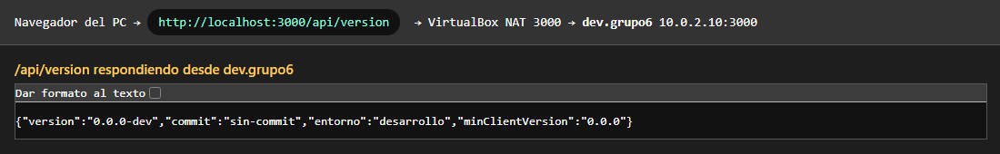
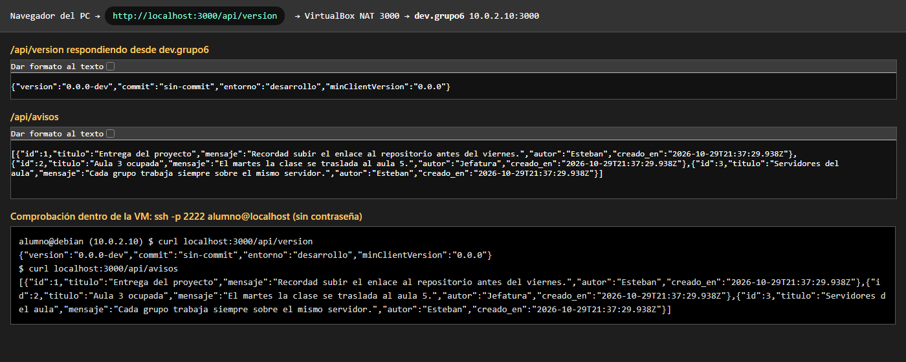

# Acceso a dev.grupo6 · Sesión 3

Máquina: **dev.grupo6** (VM 101 en el Proxmox `carlos`), IP fija `10.0.2.10`, usuario `alumno`.
Proxmox corre como VM de VirtualBox dentro de la red NAT `NatNetwork` (10.0.2.0/24).

## 0. Llegar a dev.grupo6 desde el PC (reenvío de puertos en VirtualBox)

Desde el PC no hay ruta a 10.0.2.0/24, así que se reenvían puertos de la NAT Network:

```powershell
VBoxManage natnetwork modify --netname NatNetwork --port-forward-4 "ssh-dev:tcp:[]:2222:[10.0.2.10]:22"
VBoxManage natnetwork modify --netname NatNetwork --port-forward-4 "api-dev:tcp:[]:3000:[10.0.2.10]:3000"
```

| Puerto en el PC | Destino |
|---|---|
| `localhost:8006` | Web de Proxmox (10.0.2.15:8006) |
| `localhost:2222` | SSH de dev.grupo6 (10.0.2.10:22) |
| `localhost:3000` | API del tablón en dev.grupo6 (10.0.2.10:3000) |

## 1. Par de claves y clave pública en dev.grupo6

En el PC (Windows, PowerShell):

```powershell
ssh-keygen -t ed25519 -C "hilario@grupo6" -f $env:USERPROFILE\.ssh\id_ed25519
```

Clave pública generada:

```
ssh-ed25519 AAAAC3NzaC1lZDI1NTE5AAAAIP+4AY2787ecwWWT64xrOM1msbbAc1iwe3yveZcmxX36 hilario@grupo6
```
```
ssh-ed25519 AAAAC3NzaC1lZDI1NTE5AAAAID0zciLO3yvv4Zy3HQRXbApjAbb4J/ia1nu4Kt1kJHis javi@elcampico
```

En dev.grupo6, como root (desde la consola de Proxmox):

```bash
install -d -m 700 -o alumno -g alumno /home/alumno/.ssh
echo 'ssh-ed25519 AAAAC3NzaC1lZDI1NTE5AAAAIP+4AY2787ecwWWT64xrOM1msbbAc1iwe3yveZcmxX36 hilario@grupo6' >> /home/alumno/.ssh/authorized_keys
chown alumno:alumno /home/alumno/.ssh/authorized_keys
chmod 600 /home/alumno/.ssh/authorized_keys
```

> Con la contraseña de `alumno` a mano, el equivalente desde el PC es:
> `type $env:USERPROFILE\.ssh\id_ed25519.pub | ssh -p 2222 alumno@localhost "mkdir -p ~/.ssh && cat >> ~/.ssh/authorized_keys"`

Comprobación desde el PC (entra sin pedir contraseña):

```powershell
ssh -p 2222 alumno@localhost
```

## 2. Desactivar el acceso por contraseña

En dev.grupo6, como root:

```bash
printf 'PasswordAuthentication no\nKbdInteractiveAuthentication no\nPermitRootLogin no\n' > /etc/ssh/sshd_config.d/10-sin-password.conf
sshd -t
systemctl reload ssh
```

Comprobación desde el PC:

```powershell
ssh -p 2222 alumno@localhost                                   # entra con la clave
ssh -p 2222 -o PubkeyAuthentication=no alumno@localhost        # Permission denied (publickey).
```

## 3. Instalación y base de datos

`/etc/resolv.conf` venía vacío (sin DNS), así que primero:

```bash
echo 'nameserver 10.0.2.1' > /etc/resolv.conf
apt-get update
apt-get install -y sudo git postgresql nodejs npm curl
usermod -aG sudo alumno
```

Usuario y base de datos:

```bash
sudo -u postgres psql -c "CREATE USER tablon WITH PASSWORD 'tablon';"
sudo -u postgres createdb tablon --owner=tablon
```

## 4. Clonar el proyecto

Como `alumno`, en `/home/alumno`:

```bash
git clone https://github.com/esrora/tablon-avisos.git
```

Datos de ejemplo:

```bash
PGPASSWORD=tablon psql -h localhost -U tablon -d tablon -f tablon-avisos/db/init.sql
```

## 5. Arrancar la API

```bash
cd ~/tablon-avisos/api
cp .env.example .env
npm install
nohup node --env-file=.env server.js > ~/api.log 2>&1 &
```

Comprobación en dev.grupo6:

```bash
curl localhost:3000/api/version
curl localhost:3000/api/avisos
```

Comprobación desde el navegador del PC:

- http://localhost:3000/api/version
- http://localhost:3000/api/avisos

Respuestas obtenidas:

```json
GET /api/version
{"version":"0.0.0-dev","commit":"sin-commit","entorno":"desarrollo","minClientVersion":"0.0.0"}

GET /api/avisos
[{"id":1,"titulo":"Entrega del proyecto",...},{"id":2,"titulo":"Aula 3 ocupada",...},{"id":3,"titulo":"Servidores del aula",...}]
```

Versiones instaladas: Node `v20.19.2`, PostgreSQL `17.11` (Debian 13).

## Captura

`/api/version` respondiendo desde dev.grupo6 en el navegador del PC (`http://localhost:3000/api/version`):



Las dos rutas en directo y la comprobación por SSH dentro de la VM:



## Incidencias

- **Contraseñas de la VM olvidadas**: no recordábamos la de `alumno`; se entró como `root` por la consola de Proxmox.
- **Teclado de la consola noVNC**: con el teclado en español no llegaban los símbolos (`/`, `:`, `|`, `>`), así que los comandos de los pasos 1–5 se pasaron a la VM como un script (`wget` desde el nodo Proxmox y `bash`), ejecutado como root. Las órdenes son exactamente las de este documento.
- **DNS vacío**: `/etc/resolv.conf` no tenía `nameserver`; sin él no funcionaban `apt` ni `git clone`.
- **Lentitud**: la VM corre sin KVM (`kvm: 0`, Proxmox anidado en VirtualBox), y la instalación de `npm` tardó unos 25 minutos.
- Snapshots de dev.grupo6: `recien-clonada` (sesión 2) y `sesion3-ok` (al terminar esta sesión, sin RAM).
  Tras un rollback a `sesion3-ok` hay que volver a arrancar la API (paso 5).
